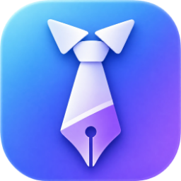
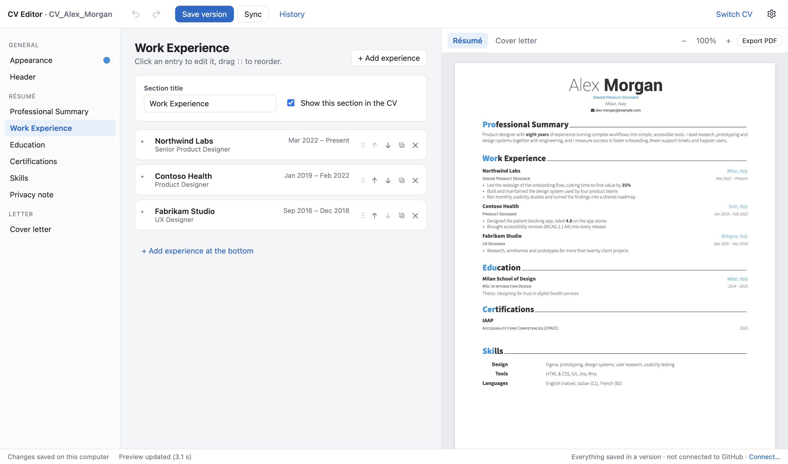
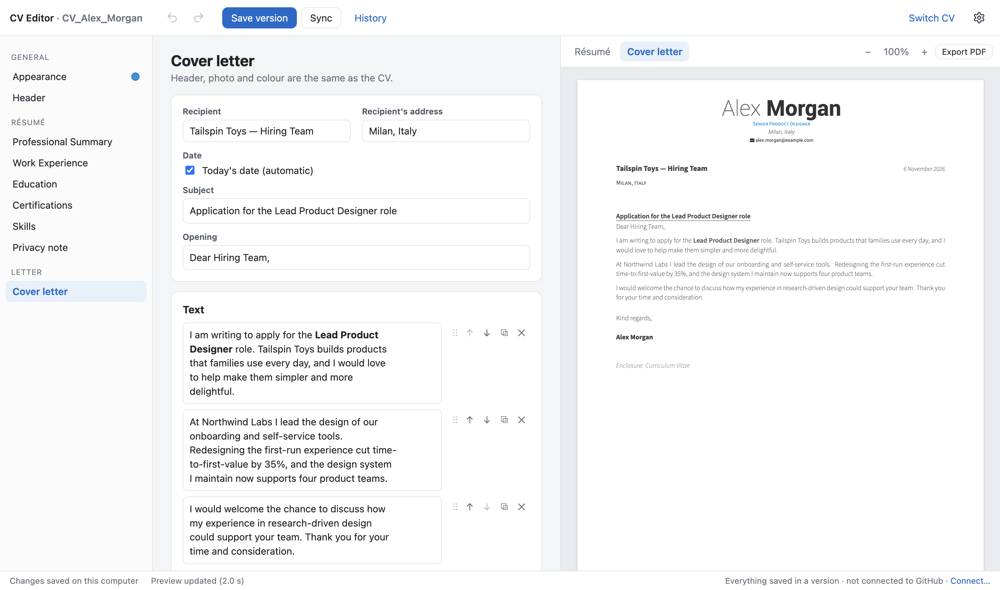
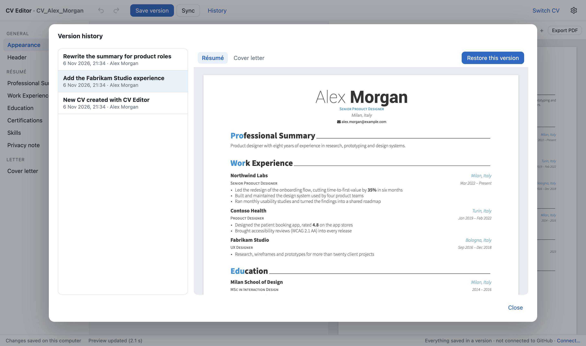
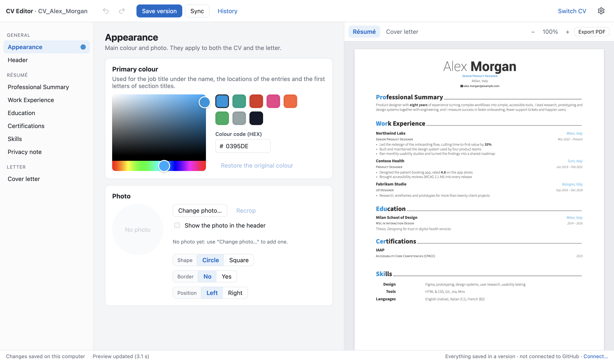
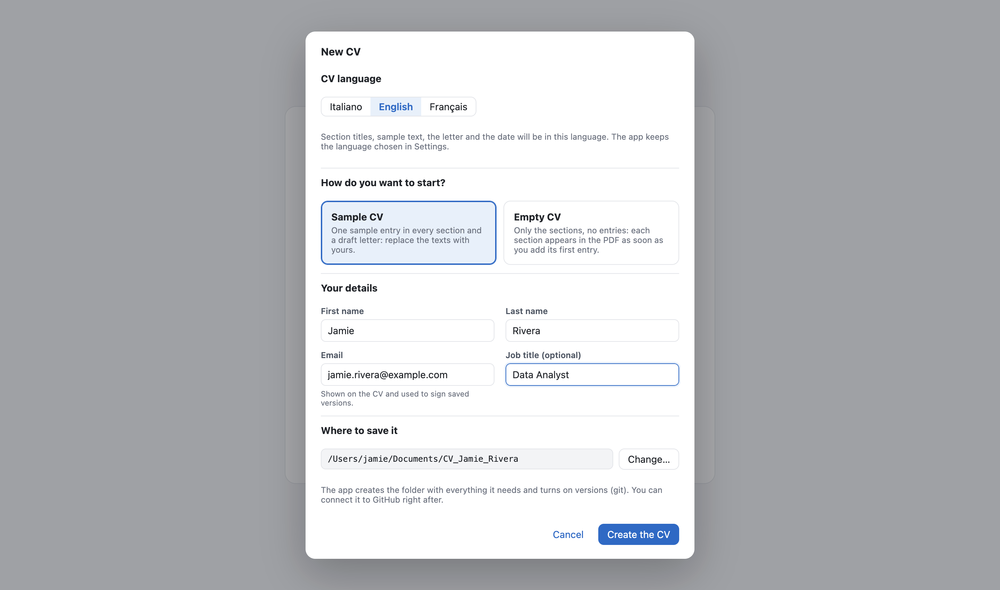
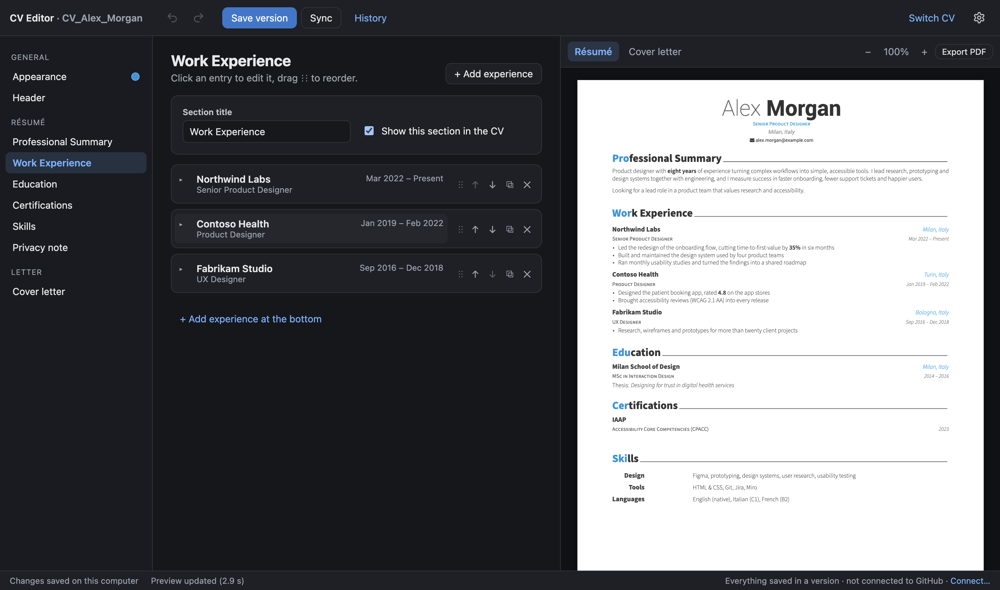
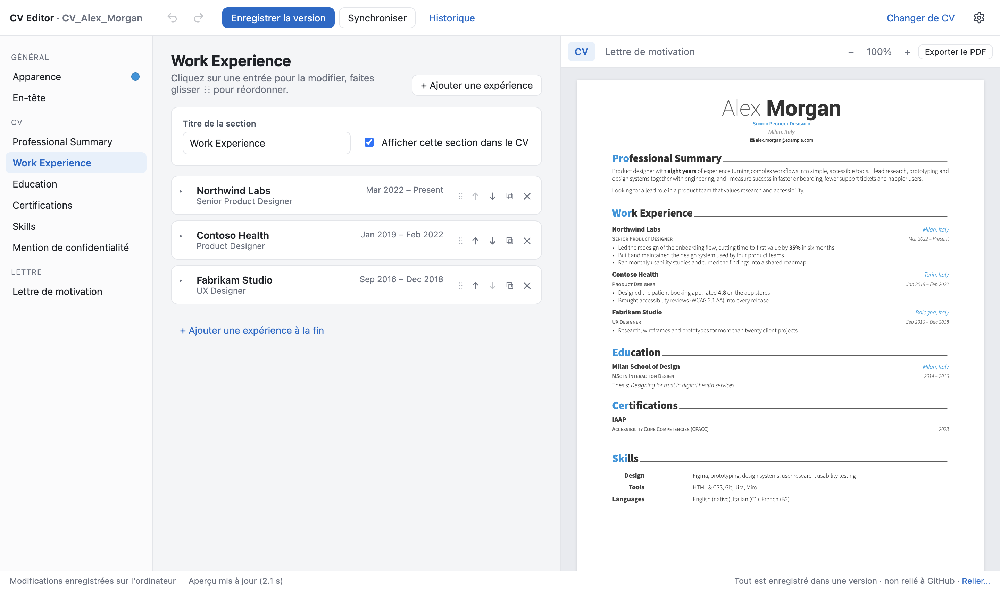
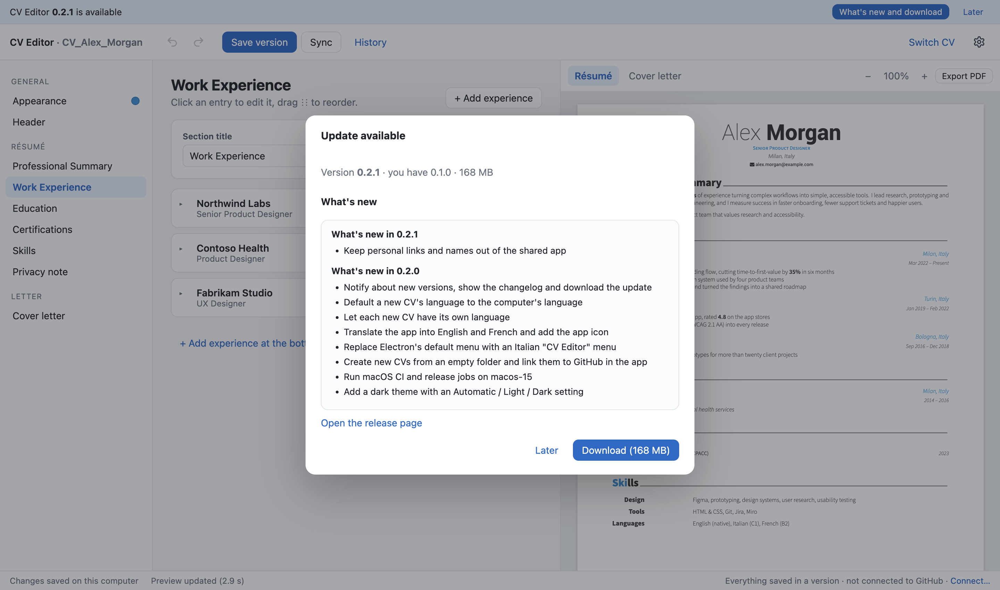

# CV Editor

**Edit your Awesome-CV résumé and cover letter — no LaTeX required.**

A desktop app for macOS and Windows: type in friendly forms, watch the real
Awesome-CV layout update a moment later, keep every version, sync with GitHub.

**[Download for Mac (Apple silicon)](https://github.com/buzzo123/cv-editor-releases/releases/latest/download/CV-Editor-mac-arm64.dmg)** ·
**[Mac (Intel)](https://github.com/buzzo123/cv-editor-releases/releases/latest/download/CV-Editor-mac-x64.dmg)** ·
**[Windows](https://github.com/buzzo123/cv-editor-releases/releases/latest/download/CV-Editor-Setup.exe)**

 

## Why CV Editor

[Awesome-CV](https://github.com/posquit0/Awesome-CV) is one of the most elegant résumé templates around — but it is written in LaTeX, and changing a date should not mean editing `.tex` files and fighting compiler errors.

CV Editor puts a friendly editor in front of the real template. You fill in forms; the app writes the LaTeX, typesets it with the bundled TeX engine and shows you the PDF. Your CV stays an ordinary folder of files on your computer, with its own history.

## Features

- **Live PDF preview** — the genuine Awesome-CV layout, rebuilt a moment after every change.
- **Friendly editors** for the header, summary, experience, education, certifications, skills and privacy note, with **bold** and *italic*, drag-and-drop reordering, duplicate and hide.
- **Cover letter** that shares the header, photo and colours of the CV.
- **Photo and colours** — crop your photo into a circle or a square, choose the accent colour, or pick it from the photo or anywhere on screen with the eyedropper.
- **Versions** — save named versions, browse the history with a preview of each one, restore any of them.
- **GitHub sync** — keep the CV in your own private repository and work on it from any computer.
- **A new CV in a minute** — start from a sample, from an empty CV or from a file, in English, Italian or French.
- **Export and import** — save the whole content of a CV (texts, letter, colour, photo) in one JSON file and start a new CV from it.
- **AI-assisted start** — copy a ready-made prompt into ChatGPT or Claude together with your old CV, and import the JSON it writes.
- **Light and dark theme**, interface in **English, Italian and French**.
- **Nothing else to install** — TeX Live 2022 (XeLaTeX) is built in.
- **Updates built in** — the app tells you when a new version is out, shows what changed and downloads it for you.

## Screenshots

<table>
  <tr>
    <td width="50%"> <b>Cover letter</b> — same header and colours as the CV, today's date in the CV's language.</td>
    <td width="50%"> <b>Version history</b> — every saved version, with a preview and one-click restore.</td>
  </tr>
  <tr>
    <td> <b>Appearance</b> — accent colour from the Awesome-CV palette or any colour, photo shape and position.</td>
    <td> <b>New CV</b> — sample or empty, in the language you choose; git is set up for you.</td>
  </tr>
  <tr>
    <td> <b>Dark theme</b> — follows your system or your choice; the PDF stays white.</td>
    <td> <b>Three languages</b> — the interface in English, Italian or French.</td>
  </tr>
</table>

## Download

| Your computer | Installer |
| --- | --- |
| Mac with Apple silicon (M1, M2, M3…) | [`CV-Editor-mac-arm64.dmg`](https://github.com/buzzo123/cv-editor-releases/releases/latest/download/CV-Editor-mac-arm64.dmg) |
| Mac with an Intel processor | [`CV-Editor-mac-x64.dmg`](https://github.com/buzzo123/cv-editor-releases/releases/latest/download/CV-Editor-mac-x64.dmg) |
| Windows 10 or 11 (64-bit) | [`CV-Editor-Setup.exe`](https://github.com/buzzo123/cv-editor-releases/releases/latest/download/CV-Editor-Setup.exe) |

Not sure which Mac you have? Open  → *About This Mac*: it says either "Chip: Apple…" or "Processor: Intel…". All versions and their changes are on the [releases page](https://github.com/buzzo123/cv-editor-releases/releases).

## Install

**Mac** — open the `.dmg` and drag *CV Editor* into *Applications*. The first time, macOS says *"Apple could not verify "CV Editor" is free of malware"*, because the app is not notarised by Apple:

1. click **Done** (not *Move to Trash*);
2. open **System Settings → Privacy & Security** and scroll down to *Security*;
3. next to *"CV Editor" was blocked to protect your Mac*, click **Open Anyway**, confirm with your password or Touch ID and click **Open Anyway** again.

This is needed only once. Updates downloaded by the app usually open directly; if macOS asks again, do the same.

**Windows** — run `CV-Editor-Setup.exe`. If "Windows protected your PC" appears, click **More info → Run anyway**. It installs for your user only and does not need an administrator password.

## Updates

From version 0.2.0 on, CV Editor looks for a new version when it starts and every few hours. When there is one, a bar at the top shows it: open it to read what changed, download the installer (its size and checksum are verified before it is opened) and install it. You can also choose **Check for Updates…** from the menu, or turn automatic checks off in **Settings → Updates**.

## Your data

- Your CV is a folder on your computer: the content in a readable `cv.yaml`, the generated LaTeX and the PDFs. Nothing leaves your computer unless you connect GitHub — and then it goes to **your own** repository.
- The app connects only to GitHub: to sync your repository, if you choose to, and to check this page for new versions. There is no tracking or analytics.
- Your GitHub sign-in is stored encrypted with your system keychain.

## User guide

A step-by-step guide (in Italian) is in [GUIDA.md](GUIDA.md): opening or creating a CV, editing, photo and colours, versions, GitHub, languages and updates.

## Third-party software

CV Editor is built on the work of others, included under their licences:

- [Awesome-CV](https://github.com/posquit0/Awesome-CV) class by Claud D. Park — [LPPL 1.3c](https://www.latex-project.org/lppl/)
- [Roboto](https://fonts.google.com/specimen/Roboto) by Google — [Apache License 2.0](https://www.apache.org/licenses/LICENSE-2.0)
- [Font Awesome 4](https://fontawesome.com/v4/) by Dave Gandy — [SIL Open Font License 1.1](https://openfontlicense.org)
- [Source Sans Pro](https://github.com/adobe-fonts/source-sans) by Adobe, from TeX Live — [SIL Open Font License 1.1](https://openfontlicense.org)
- [TeX Live 2022](https://tug.org/texlive/) (XeTeX, xdvipdfmx and LaTeX packages) — free software licences; sources at [tug.org](https://tug.org/texlive/acquire.html)
- [Electron](https://www.electronjs.org), [React](https://react.dev), [TipTap](https://tiptap.dev), [isomorphic-git](https://isomorphic-git.org), [PDF.js](https://mozilla.github.io/pdf.js/) and other open-source libraries

---

CV Editor · © 2026 Buzzo

